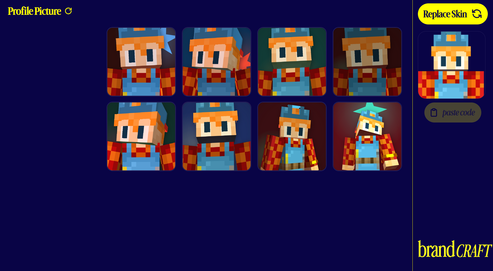

# brandcraft

Minecraft skin goes in, profile picture comes out. Also a YouTube banner. All of it renders in the browser with WebGL, so the skin file never touches a server.


*One button, one input. No account, no queue.*

## what you actually get

Drop a skin and the app rolls eight poses of it, each framed as a square PFP at 1024, 2048 or 4096 pixels.

The hard part of a Minecraft PFP is that the face has to read at 96 px in a Discord member list. Eight finished starting points beat one empty orbit slider, because you can compare them side by side and pick a direction.


*Eight presets, from neutral Classic to the leaned-back Recline. The rail on the right swaps the skin without losing your place.*

Then you make it yours. Every preset is a starting point, not a locked template.

## the editor


*Same skin, camera orbit at -9°, bust crop at 54%, and the share code updating live in the bottom bar.*

Five groups of controls, all of them live:

- Camera: orbit, height, distance
- Framing: bust size and its horizontal/vertical offset, which is the crop that becomes your PFP square
- Pose: pitch, turn and tilt on every bone in the skeleton, applied on top of the preset
- Star: the four-pointed mark behind the head, with point count, position, size and rotation
- Light: key, fill and rim lamps (azimuth, elevation, intensity) plus ambient and contrast

Esc commits and goes back. Nothing is written to disk until you ask for it.

## download


*1024, 2048 or 4096. The preview is the exact square that ships.*

PNG, 1:1, with the preset backdrop and star baked in. 4k for a channel avatar, 1k for a chat icon.

## share codes

Every look compresses into one line of text:

```
MC1|hd:-6,20,-5|bd:-4,-10,0|ra:18,0,-8|la:-12,0,8|cam:-0.15,1.7,33|crop:23,5,54,54|bg:#153329|star:6,86,50,22,20,#f45288|light:k=-30,26,-34,1.05;f=26,30,30,1;r=40,20,10,1.2;a=0.62;c=0.2
```

Paste it back and you land on the same render. Paste it at someone else and they get your exact framing on their own skin. A malformed code gets rejected outright, so a bad paste never drops you into a half-broken editor.

## youtube banner

Channel art has rules most people find out about after the crop looks wrong on a TV. brandcraft draws the real thing: a 2560×1440 frame with the 1546×423 strip every phone and desktop shows.

- Banners are a section under the profile picture grid, four to a row across the full stage width. Each card is the strip itself, 3.655:1, so nothing gets letterboxed or clipped
- Two figures per banner, extreme left and extreme right, standing on the strip floor and fully inside it: 26 px of air between a bust and the strip edge, so no silhouette is ever sliced
- "Subscribe" centred on the strip, ink measured to the pixel. The wordmark box is the clear gap between the two busts, so the type can never crowd a pose
- Four banners, each with its own typeface, lighting family, text scale and slot pairing, and its own randomizer: rolling one leaves the other three alone
- Five typefaces: caps, roman, italic, Inter italic and Advercase
- Three lighting families (flat, editorial, rim) built on each preset's own rig, so a banner figure is lit the way its profile card is lit, only pushed outward. The refresh button on a card re-rolls that card's typeface, lighting, wordmark size and preset pairing, never lands on the look it already had, and leaves the other three cards untouched
- Every pixel outside the strip is one flat colour taken from the preset backdrop. No star, no scrim, no vignette
- Exports at 1280, 2048 or 2560 wide. PNG by default; anything that would cross YouTube's 6 MB cap gets written as JPEG 0.92 instead

Four banners, one capture job. Card `k` puts slot `k` on the left and the slot `pairOffset` further along on the right, so no card repeats a pose and the pairing is itself part of the roll.

## run it

```bash
npm install
npm run dev        # vite dev server
npm run build      # tsc --noEmit via typecheck, then vite build
npm run typecheck
```

React 19, TypeScript strict, Vite 8, zustand for state, motion for transitions, and [`@daidr/minecraft-skin-renderer`](https://github.com/daidr/minecraft-skin-renderer) for the WebGL skin viewport. Presets live in plain text at [slots.txt](src/preset/slots.txt), one line per card, in grid order — edit that file and the grid follows.

One skin viewer is shared by everything. Renders queue through a single promise chain, because two WebGL captures at once corrupt the context.

## proof, not vibes

`verify.states.json` drives headless Chrome through the real flows: drop a skin, wait for the banner section, click a card, click an export size. Each state is a scripted run, and the probe asserts numbers instead of taking a screenshot. Point the `verify` skill at a preview server (`npm run preview`, port 4173) and ask for a state:

```
--state banner-section  four cards at strip aspect, spanning the full stage width
--state banner-frame    paint order, wordmark ink centring, flat sides, ink pixel count
--state banner-export   clicks 2560, checks the frame size and the byte count
```

Current numbers: cards span the full 1021 px stage width at 3.655:1 and sit 110 px below the preset grid, the 1600×900 banner preview samples as one flat RGB value outside the strip with the wordmark ink drifting 0 px off centre at 19.9 % of the frame width, and the 2560×1440 export comes out around 187 KB in 158 ms at the same 20.39 % text box.

GPL-3.0, see [LICENSE](LICENSE).
