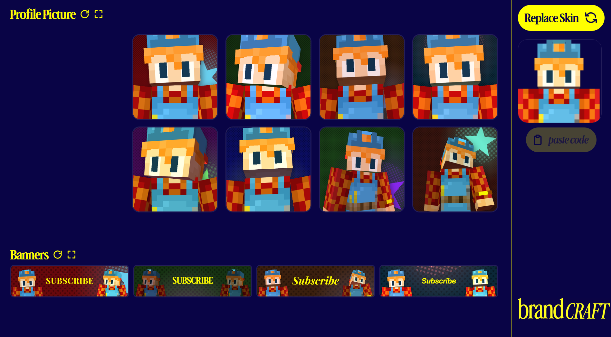
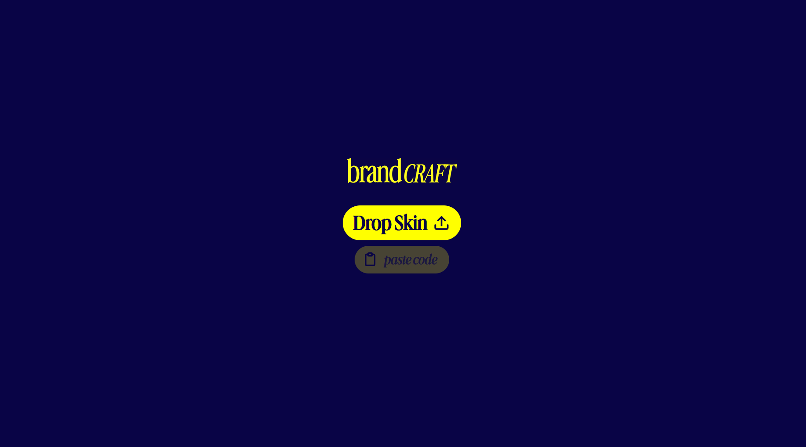
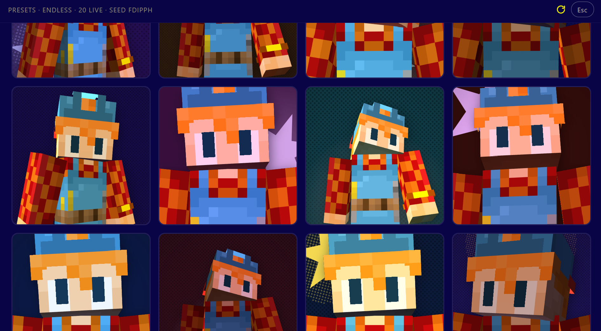
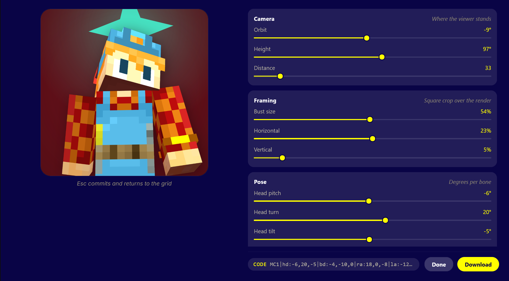
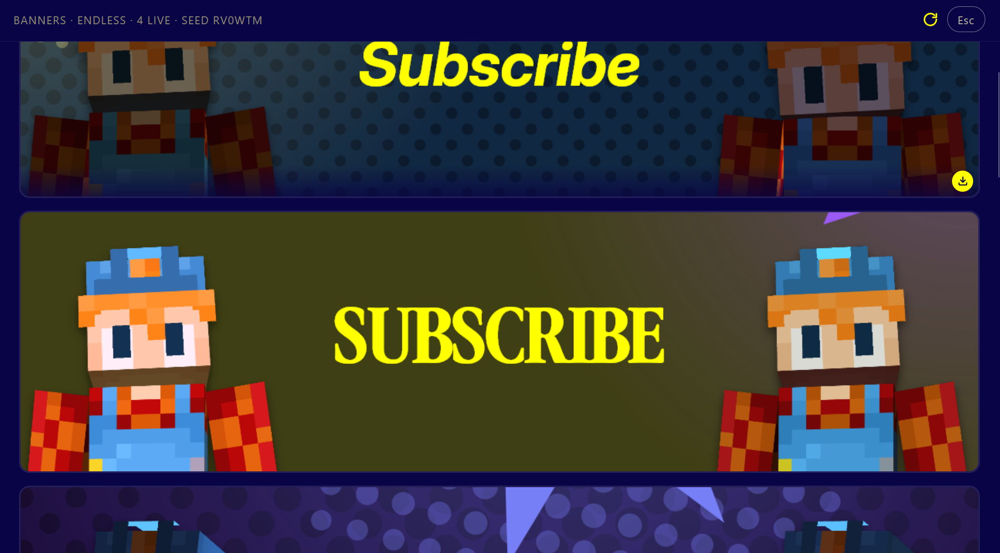
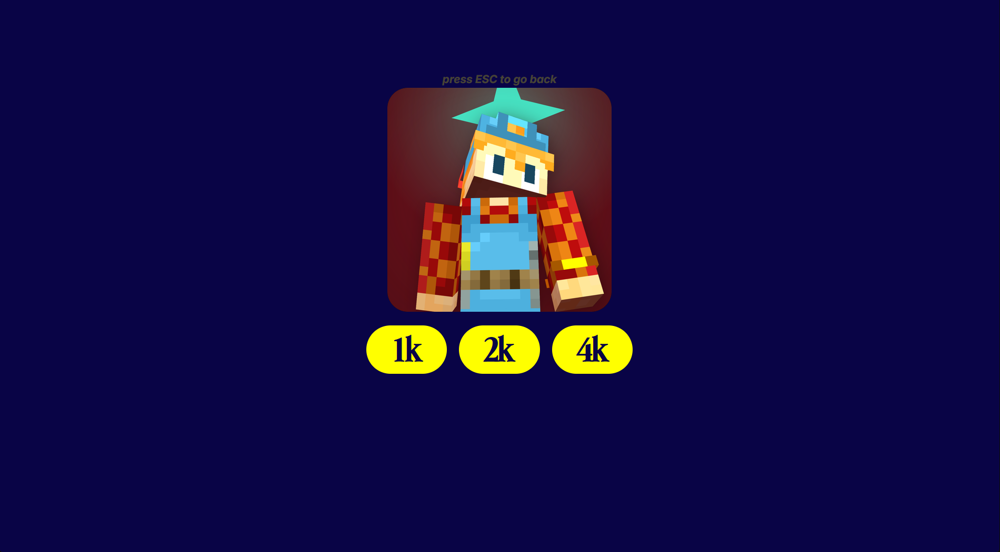

# brandcraft

Browser-native Minecraft skin renderer. Turn a skin file into print-grade profile avatars and calibrated YouTube banner art without a backend, account, or cloud queue. Everything computes client-side via WebGL.



---

## Output Quality

Rendered sample exported directly at 2048×2048 with riso halftone screening, three-point directional lighting, and contact shadow:

<p align="center">
  
</p>

---

## Workflow

### 1. Drop Skin
Drag and drop your skin PNG or paste a base64 share code. No upload latency. The skin never leaves your browser.



### 2. Compare Presets
Eight distinct studio presets render in one batch. Poses range from neutral portrait framing to dynamic leaned angles. The right-hand rail keeps skin swaps instant while preserving your active workspace.



### 3. Fine-Tune in the Studio Editor
Tweak camera angles, bone rotations, lighting rigs, and halftone print patterns with live preview feedback.



Forty-six fine-grained controls across five groups:

- **Camera**: Orbit azimuth, elevation, camera distance
- **Framing**: Bust scale and XY offset inside the square crop
- **Pose**: Bone-level pitch, roll, and yaw for head, torso, and limbs
- **Star & Backdrop**: Geometric star backdrop with point counts, anchor positions, and riso dot pitch
- **Three-Point Rig**: Directional key, fill, and rim lamps with independent hue derivation and ambient contrast

Press `Esc` to commit changes and return to the stage.

### 4. YouTube Banner Suite
Generates 2560×1440 channel art fitted with YouTube's 1546×423 mobile-and-desktop safe strip. Dual character busts anchor flush to the strip edges while custom typography centers cleanly in the negative space.



- **Layout**: 3.655:1 strip aspect ratio; figure scale locked to 92% headroom.
- **Lighting Families**: Flat, editorial, and rim rig configurations mapped per side.
- **Typography**: Five display typefaces tuned with pixel-exact cap-height measurements.
- **File Guard**: Automatic PNG export; falls back to JPEG (quality 0.92) if the file approaches YouTube's 6 MB ceiling.

### 5. Multi-Scale Export
Export uncompressed 1:1 square profile images at 1K, 2K, or 4K.



---

## Share Codes

Preset configurations serialize into compact, URL-safe strings:

```text
MC1|hd:-6,20,-5|bd:-4,-10,0|ra:18,0,-8|la:-12,0,8|cam:-0.15,1.7,33|crop:23,5,54,54|bg:#153329|star:6,86,50,22,20,#f45288|light:k=-30,26,-34,1.05;f=26,30,30,1;r=40,20,10,1.2;a=0.62;c=0.2
```

Share codes encode camera angles, skeleton poses, crop coordinates, backdrop colors, and light vectors. Paste a code anywhere in the interface to recreate the exact studio setup on any skin.

---

## Technical Stack

- **Runtime**: React 19, TypeScript (strict), Vite 8
- **Renderer**: [`@daidr/minecraft-skin-renderer`](https://github.com/daidr/minecraft-skin-renderer) with custom WebGL lighting shader plugin
- **State**: Zustand
- **Animations**: Motion
- **Presets**: Plain-text definitions parsed from [`src/preset/slots.txt`](src/preset/slots.txt)

---

## Development

```bash
# Install dependencies
npm install

# Start Vite dev server on port 5173
npm run dev

# Run strict type checking and build
npm run typecheck
npm run build

# Preview production build
npm run preview
```

---

## Automated Verification

Headless Chrome test suites run through `verify.states.json` to validate rendering passes and layout metrics:

```bash
# Verify banner section geometry, ink boundaries, and export sizes
node C:\Users\jesmi\.dsh\skills\verify\bin\verify.mjs check --url http://127.0.0.1:4173/ --state banner-section
node C:\Users\jesmi\.dsh\skills\verify\bin\verify.mjs check --url http://127.0.0.1:4173/ --state banner-frame
node C:\Users\jesmi\.dsh\skills\verify\bin\verify.mjs check --url http://127.0.0.1:4173/ --state banner-export
```

---

## License

GPL-3.0. See [LICENSE](LICENSE).
